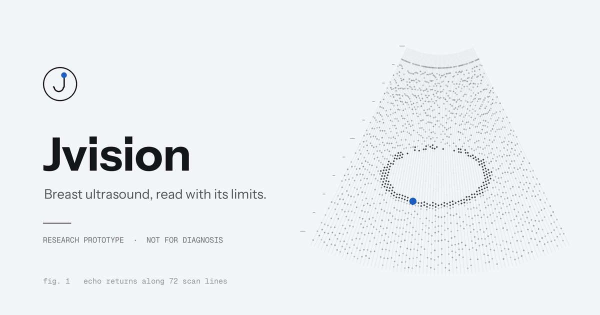

# Jvision

**Breast ultrasound, read with its limits.** Jvision is a research prototype that runs a trained ultrasound image model and shows its result next to the checks behind it.

> **Research and education only.** Jvision is not a medical device and has no clinical validation. Do not use its output for diagnosis, treatment, triage or any patient-care decision.



## What it does today

You upload a breast image. The API works out whether it is an ultrasound or a mammogram, then scores it as benign, malignant or normal with a model checked for that type. The screen shows:
- the result
- the score for each class
- the detected image type
- any warnings
- which models are in use, and why

| Model | Architecture | Status |
| --- | --- | --- |
| Image type detector | ResNet-50 (MedCLIP vision encoder) + 2-class head | **In use.** It only knows ultrasound and mammogram, and it cannot reject other images. |
| Ultrasound model | EfficientNet-B0 | **In use.** Passed a sanity check on public BUSI images (10 of 12 matched their labels; the images may overlap its training data). |
| Mammogram model | EfficientNet-B0 with a 512-unit head | **Off.** It has never been checked. Mammograms get no result. |
| Clinical model | TabNet on 9 clinical features | **Off.** It failed sanity checks: it never predicts malignant, and it gives benign-looking and biopsy-proven cases the same class. It needs retraining. |

The full probe record is in [.10x/reviews/2026-11-03-model-probe.md](.10x/reviews/2026-11-03-model-probe.md). Trust is set in code, in [src/app/models.py](src/app/models.py), and only changes together with a new probe record.

Clinical details can still be entered. They are validated and saved with the case, but no model uses them.

## Layout

```
frontend/          Vite + TypeScript app (no framework)
  src/             api, render, history, form, styles
  public/          favicon, social image, two BUSI sample images
src/app/           FastAPI service: config, schemas, models (trust), fusion, predictor, weights
scripts/           probe_model.py: sanity probes against the real weights
tests/backend/     pytest contract tests (fake predictor, no weights needed)
tests/frontend/    Vitest tests for rendering, history, the form and frontend/backend agreement
notebooks/         original research notebooks
.10x/              design spec, ADRs, decisions and review records
```

## Run it

**API** (Python 3.10+). The weights, about 230 MB, download once from the Hugging Face Space, pinned to a fixed revision.

```bash
python -m pip install --extra-index-url https://download.pytorch.org/whl/cpu -r src/requirements.txt
```

```bash
uvicorn app.main:app --app-dir src --port 8000
```

**Frontend** (Node 20+):

```bash
npm install
```

```bash
npm run dev
```

Open http://localhost:5173. To point at another API, set `VITE_API_URL` (for example in `.env.local`).

### API settings

| Variable | Default | Meaning |
| --- | --- | --- |
| `ALLOWED_ORIGINS` | local dev and preview ports | Comma-separated origins allowed by CORS |
| `MODEL_DIR` | `models` | Where the weights live |
| `MODEL_REVISION` | the probed Space commit | Weights revision; re-run the probe if you change it |
| `DOWNLOAD_WEIGHTS` | `true` | Fetch missing weights from the Hub |
| `MAX_UPLOAD_MB` | `10` | Largest accepted image |

### API

- `GET /health` lists every model and its state (`ready`, `disabled`, `missing`, `failed`). It always answers, even while the models load.
- `POST /predict` takes a multipart `image` (required) and an optional `clinical_data` JSON string. It returns `result` (or `null`), `experts`, `modality`, `warnings` and `model_revision`. Invalid input gets a 400, 413, 415 or 422 with a plain message. The browser never makes up a result when the API fails.

## Checks

```bash
python -m pip install -r src/requirements-dev.txt
```

```bash
python -m pytest
```

```bash
npm run typecheck && npm test && npm run build
```

To re-check the models against real weights (needs the full requirements and a folder of labelled images named `benign_*`, `malignant_*`, `normal_*`):

```bash
python scripts/probe_model.py --images path/to/images
```

## Deploy

`.github/workflows/deploy-space.yml` uploads `src/` to the Hugging Face Space when a `v*` tag is pushed. It needs a repository secret `HF_TOKEN` with write access to the Space. In the Space settings, set `ALLOWED_ORIGINS` to the address the frontend is served from. The frontend builds to `dist/` and can be served from any static host (`npm run build`).

## Credits

Sample images are from the BUSI dataset (Al-Dhabyani W., Gomaa M., Khaled H., Fahmy A., *Dataset of breast ultrasound images*, Data in Brief, 2020), via the Hugging Face mirror `theshoaibme/panorgan-busi-breast-ultrasound` (CC BY 4.0).

MIT licence. See [LICENSE](LICENSE).
